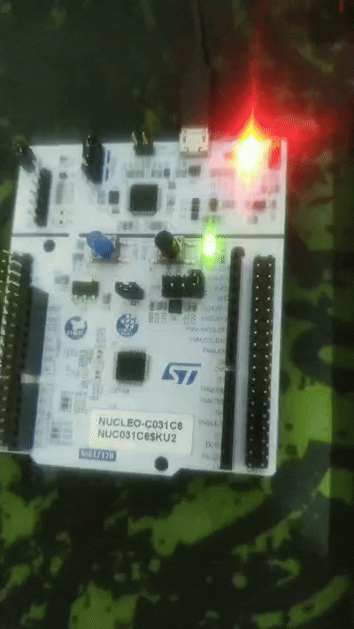
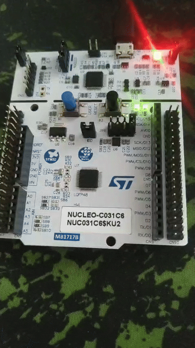
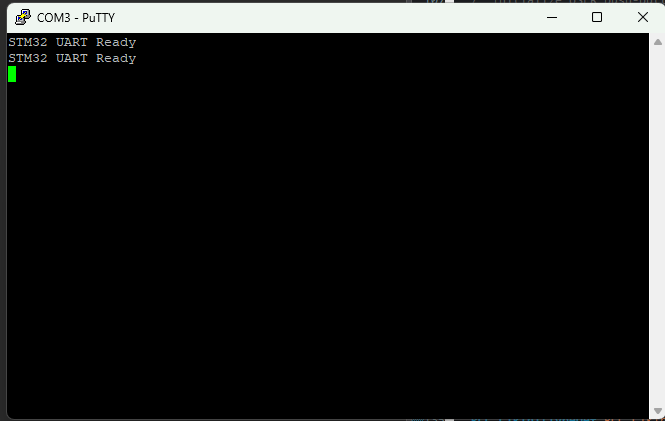

# stm32-power-monitor

This repository documents my journey of developing an embedded power monitor application on the **STM32C031C6 (Nucleo-C031C6)**, moving from standard HAL libraries directly down to bare-metal **Register-Level** programming.

### 💻 Development Milestones
## 1. Button_GPIO_register:

## 2. EXTI_interrupt_for_user_button:

## 3. Register_level_EXTI_interrupt_for_user_button:

## 4. Timer_interrupt_for_periodic_LED_control:

## 5. UART polling-based communication:

